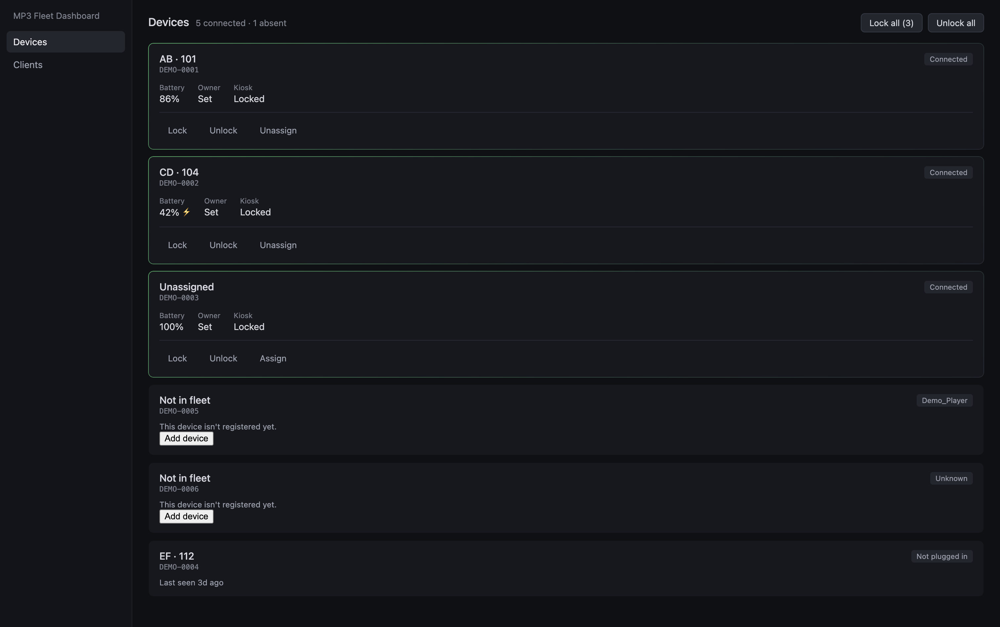
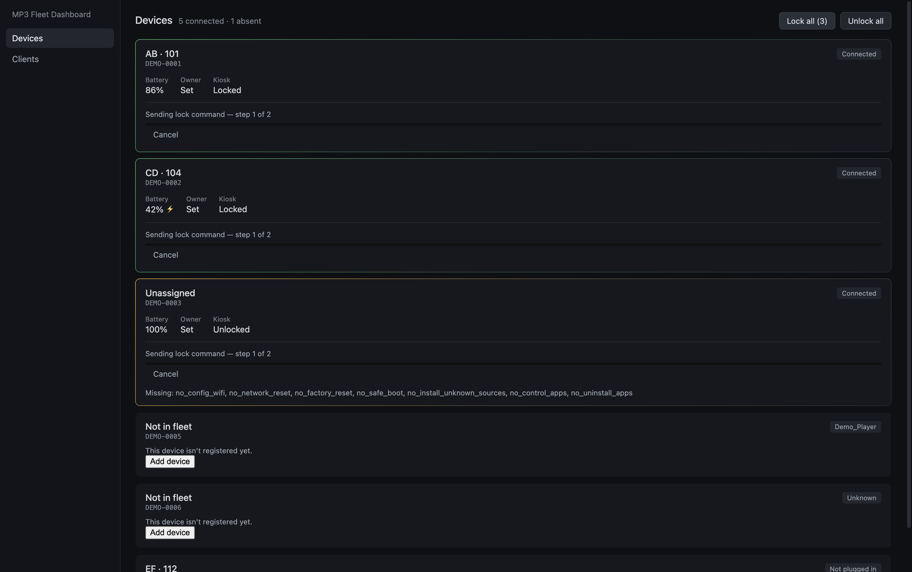
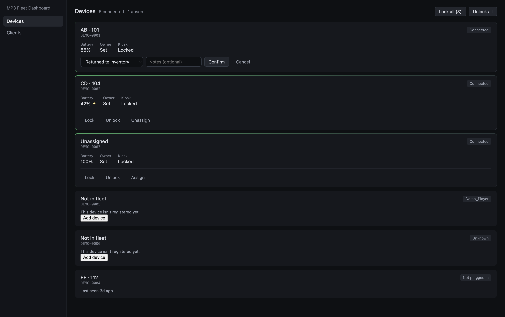
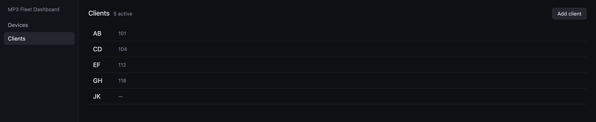

# MP3 Fleet Dashboard (kiosk-console)

A desktop app for managing a fleet of locked-down Android media players over USB. Staff use it to see which devices are plugged in, lock or unlock them in kiosk mode, and track which client each device is assigned to.

For the background and design decisions behind this project, read the [case study on my portfolio](https://cameronbibb.com/work/mp3-fleet-manager/).

Built with Electron, React, TypeScript and SQLite. It talks to devices through `adb`, and to the companion kiosk app (`com.kumh.mp3kiosk`) running on each device as its Device Owner.



## Features

- **Live device view.** Polls `adb devices` every 2 seconds and shows each connected device's connection state, battery, and lock status.
- **Fleet adoption.** Devices are added to the fleet explicitly. Unknown serials show up as "adoptable" and nothing is written for them until someone adopts them.
- **Lock / unlock.** Sends a command to the kiosk app, then reads the device's policy back to confirm the restrictions actually changed. Runs up to 4 devices at a time with live progress, and tasks can be cancelled.
- **Clients and assignments.** Records which client has which device, with full history. One device can only have one open assignment at a time. Unassigning records a reason (released, returned, broken, lost) and optional notes.

## Screenshots

All screenshots use demo mode (`npm run start:demo`). The initials, rooms and serials are made up.

**Locking several devices at once.** Each device shows its current step.



**Unassigning a device.** Staff choose a reason and can add a note.



**Clients.** Listed by initials and room only.



## Requirements

- Node.js 20+
- `adb` (Android Platform Tools) on your `PATH`
- Devices provisioned with the kiosk app as Device Owner, and USB debugging authorized for this computer
- The shared kiosk command token (see below)

## Getting started

```sh
npm install
cp .env.example .env   # then fill in KIOSK_TOKEN
npm start
```

`npm start` runs the app in development mode with hot reload. DevTools opens automatically.

### Configuration

The app reads one setting from `.env` in the project root:

```
KIOSK_TOKEN=<shared secret configured in the kiosk app>
```

The kiosk app rejects any command without the matching token. `.env` is gitignored. Never commit it.

## Scripts

| Command           | What it does                                         |
| ----------------- | ---------------------------------------------------- |
| `npm start`       | Run the app in development                           |
| `npm run start:demo` | Run with fake devices and made-up clients on a separate database (no adb needed). Use this for screenshots. Development only: installed builds ignore it. |
| `npm run lint`    | Lint all `.ts` / `.tsx` files                        |
| `npm run package` | Build the app for the current platform               |
| `npm run make`    | Build installers (Squirrel, ZIP for macOS, deb, rpm) |

## Project structure

```
src/
  main.ts                  Electron entry: opens the DB, registers IPC, starts the watcher
  preload.ts               Exposes window.api to the renderer
  main/
    db/                    SQLite connection, migration runner, SQL migrations
    features/
      clients/             Client identifiers for device assignment, and their IPC handlers
      devices/
        adb.service.ts     adb calls and kiosk commands
        watcher.ts         Polls for connected devices and pushes fleet updates
        parsers.ts         Parses adb / dumpsys output
        lockdown.ts        Decides whether a device counts as locked
        tasks.ts           Lock/unlock task queue
        task-definitions.ts  Steps for each task
        __fixtures__/      Sample dumpsys output for parser tests
  renderer/                React UI (Devices and Clients pages)
  shared/                  Types and the window.api contract, used by both sides
```

Imports use the path aliases `@main/*`, `@renderer/*` and `@shared/*` (see `tsconfig.json`).

### How a device command works

1. The renderer calls `window.api.devices.runTask(serial, "lock")`.
2. The main process queues the task and runs its steps in order.
3. The first step sends an `adb shell am broadcast` to the kiosk app's `KioskControlReceiver`, with the action and token as extras. The result code says whether it succeeded, the token was wrong, or the action is unknown (an outdated kiosk app).
4. The verify step reads `dumpsys device_policy` and checks that the required restrictions (no Wi-Fi config, no factory reset, no safe boot, no app installs or uninstalls, and so on) are actually in place.
5. Progress is pushed to the renderer after every step.

## Data and privacy

The database is a local SQLite file stored in Electron's user data folder, **not** in this repo:

- macOS: `~/Library/Application Support/kiosk-console/kiosk-console.db`

It stores the minimal identifiers needed to track which client has which device (initials and room), so treat it as sensitive:

- Clients are identified by **initials and room only**. Don't store full names.
- The assignment **notes** field is free text. Keep identifying details out of it.
- `*.db`, `*.db-*` and `*.sqlite*` are gitignored. Never commit a copy of the database, an export, or real client data as test fixtures.
- The file is not encrypted by the app. Rely on disk encryption (FileVault) and account access on the machine running it.

Migrations live in `src/main/db/migrations/` and run automatically at startup. To add one, create the next numbered `.sql` file and register it in `migrations/index.ts`.

## Current limitations

- `adb` is taken from `PATH`. Bundling the binary with the app is not done yet.
- Lock/unlock task history is kept in memory and lost on restart. The `device_tasks` table exists but isn't written to yet.
- No automated tests yet. The parser fixtures are ready for them.
- There is an issue with serial numbers not being unique on some devices. A fix is to utilize another unique identifier, either MAC address or Bluetooth address.
- Some devices report the same serial number, but the serial is used as each device's ID. Duplicates can't be told apart and would share one record. Planned fix: identify devices by Wi-Fi MAC or Bluetooth address instead.

## License

MIT
